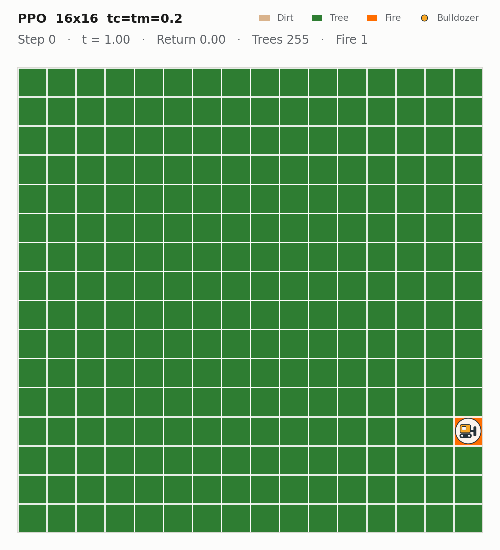
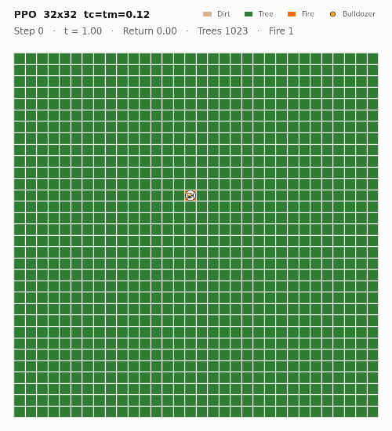
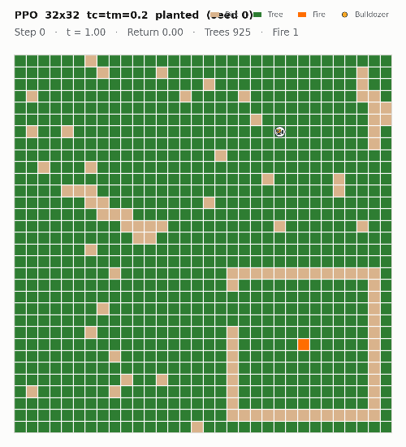

# SteerCA

**Reinforcement learning environments for controlling cellular automata, with difficulty set by construction.**

In SteerCA, an agent moves over the grid of a cellular automaton (CA) and changes
the cell it stands on, racing the automaton's own dynamics. Every action costs CA
time, so the cost of acting is a single, continuous difficulty knob whose effect
on the solution can be derived. The environments are written in PyTorch and run
thousands of episodes in parallel on one GPU.

**Firebreak** is the suite studied in the papers: a fire spreads over a forest
and a bulldozer cuts trees to build firebreaks. It comes with a hand-designed
barrier planner as a reference, and with *planted* instances whose optimal
answer is certified at reset.

<p align="center">
  
  
  
</p>

This repository lets you:

1. **[Train agents](#1-train-an-agent-on-firebreak)** on Firebreak with PPO, A2C or SAC, from 8×8 to 32×32 and beyond.
2. **[Build new environments](#2-build-a-variant-or-a-new-automaton)**: a variant of Firebreak, or a new cellular automaton from scratch.
3. **[Reproduce the papers](#3-reproduce-the-papers)**, from redrawing a figure in a minute to retraining every run.

---

## Install

Python 3.10+ and a CUDA GPU for training (CPU works for tests, evaluation and the examples).

```bash
git clone https://github.com/Pukuh/SteerCA.git && cd SteerCA
pip install -e .            # torch 2.8, torchrl 0.10, tensordict 0.10, ...
pip install -e ".[dev]"     # + pytest
python -m pytest            # ~2 minutes
```

The pinned versions are the ones every published result was produced with. If
you need another CUDA build of torch, install it first, following
[pytorch.org](https://pytorch.org), then `pip install -e .`.

To use the published checkpoints (for evaluation, warm starts or reproducing the papers):

```bash
python tools/fetch_artifacts.py      # ~1.1 GB into ./artifacts, sha256-verified
```

They are archived on Zenodo: [10.5281/zenodo.23328417](https://doi.org/10.5281/zenodo.23328417).
Zenodo can be slow (a test download took 7.5 minutes); the script shows progress.

## Quickstart

```python
import torch
from steerca.evaluate import run
from steerca.firebreak.env import episode_cap, make_env
from steerca.firebreak.planner import BarrierPlannerPolicy

env = make_env(16, 0.2, 0.2, batch=64, device="cuda")   # 64 forests, stepped together
torch.manual_seed(0)
env.set_seed(0)
result = run(env, env.reset(), BarrierPlannerPolicy(), episode_cap(16, 0.2, 0.2), 16)
print(f"the planner saves {100 * result['saved']:.1f}% of the forest")
```

```bash
# Train PPO on 16x16 with tc = tm = 0.2 (a move and a cut each take 0.2 CA updates)
STEERCA_N=16 STEERCA_TC=0.2 STEERCA_TM=0.2 python -m steerca.train

# Score a policy against the planner on 100 identical episodes
python -m steerca.evaluate --n 16 --costs 0.2,0.2 --episodes 100 \
    --ckpt artifacts/models/ppo_equiv_c96_b6_512_64_1hot_16x16_t0.2_0.2_cut0.5_r10_policy.pth
```

## The environment in one screen

| | |
|---|---|
| **Grid** | `n × n`, one-hot `DIRT` / `TREE` / `FIRE`; every reset is a full forest with one random ignition |
| **CA rule** | a tree with a burning Moore neighbour ignites, fire burns out to dirt; one update moves the front one cell |
| **Agent** | 8 moves + `cut` (tree → dirt) at its own cell |
| **Time** | a move takes `tm` CA updates and a cut `tc`; the CA advances as the agent's clock passes each update |
| **Difficulty** | `s = tc + tm`: closed rings work below 1/8, spirals below 1, above 1 only losses can be limited |
| **Reward** | `-(trees burnt + 0.5 · cuts) / n²` |
| **Score** | **trees saved**: the share of the grid still forested when the fire burns out |
| **End** | the CA's fixed point (no fire left) |
| **Reference** | `BarrierPlannerPolicy`: rectangles and spirals planned against exact fire arrival times |

> **Score on trees saved, never on return.** A cut costs 0.5 and a burnt tree 1,
> so cutting a tree that would burn anyway *pays*, whether or not it helps. That
> is what makes the task learnable, and it means return can rise while nothing
> is saved. Evaluation reports both, and checkpoints are selected on trees saved.

Full definition: [docs/environment.md](docs/environment.md).

---

## 1. Train an agent on Firebreak

One run, configured entirely by environment variables:

```bash
STEERCA_N=8 STEERCA_TC=0.06 STEERCA_TM=0.06 python -m steerca.train
```

Every 25 batches it prints an evaluation on 100 episodes (`eval saved …% (return …)`), writes the
best checkpoint by trees saved to `models/<experiment name>_{policy,value}.pth`
and the final one to `…_final_{policy,value}.pth`, and logs metrics as CSV under
`logs/csv/`. Re-running the same command resumes from the checkpoint.

**The warm-start ladder.** The network has no parameter that depends on the grid
size, so a policy trained at 8×8 runs at 16×16 and 32×32. Training up the
ladder is far cheaper than training at 32×32 from scratch:

```bash
scripts/run_pipeline.sh 0.2                 # 8x8 -> 16x16 -> 32x32 at tc = tm = 0.2
scripts/run_pipeline.sh 0.06 0.12 0.2 0.3   # one ladder per cost
STEERCA_SIZES="8 16" scripts/run_pipeline.sh 0.05,0.03   # tc = 0.05, tm = 0.03, two stages
```

Each stage warm starts from the stage below with the same costs, and at 32×32
the trunk grows dilated blocks that start as the identity. Before training, the
script prints which barriers the chosen cost allows.

**Settings** (each also accepted as `CARL_*`, the spelling in the papers):

| variable | default | meaning |
|---|---|---|
| `STEERCA_N` | 16 | grid size |
| `STEERCA_TC`, `STEERCA_TM` | 0.05 | CA updates per cut / per move |
| `STEERCA_ALGO` | `ppo` | `ppo`, `a2c` or `sac` |
| `STEERCA_FRAMES` | 4000000 | training frames |
| `STEERCA_SEED` | unset | global seed (unset: a random one) |
| `STEERCA_INIT_FROM` | auto | warm-start checkpoint; `none` for scratch; auto = the ladder's stage below |
| `STEERCA_TAG` | unset | suffix for the experiment name, so a re-run does not resume an existing run |
| `STEERCA_PLANTED` | unset | train on planted instances ([docs/planted.md](docs/planted.md)) |
| `STEERCA_ENV` | `firebreak` | train on another environment: `module:factory` returning a `CASpec` |
| `STEERCA_LR`, `STEERCA_EPOCHS`, `STEERCA_ENTROPY` | 1e-4, 10 (1 for A2C), 5e-3 | learner settings |
| `STEERCA_REWARD_SCALE` | 1 | multiply the learner's reward (`area` = n²; used for SAC) |
| `STEERCA_SAC_ALPHA_INIT`, `STEERCA_SAC_TARGET_ENTROPY` | 1.0, 0.98 | SAC temperature |
| `STEERCA_WARM_LR_SCALE` | 0.3 | learning-rate factor when warm starting |
| `STEERCA_KEEP_CRITIC` | 0 | keep the value head across a warm start that changes the instance distribution |
| `STEERCA_ARCH` | auto | force a backbone, e.g. `c96_b6_512_64` |
| `STEERCA_CUT_TREE_AHEAD`, `STEERCA_CUT_TREE_IMMINENT` | 0, 0 | extra charge for felling a tree ([pricing](docs/environment.md#reward)) |
| `STEERCA_DEVICE` | `cuda` if available | |
| `STEERCA_MODELS`, `STEERCA_LOG_DIR` | `./models`, `./logs/csv` | output folders |
| `STEERCA_WANDB` | 0 | `1` logs to Weights & Biases instead of CSV (`pip install -e ".[wandb]"`); `STEERCA_WANDB_PROJECT`, `STEERCA_WANDB_ENTITY` |
| `STEERCA_SIZES`, `STEERCA_FRAMES_<N>` | `8 16 32` | ladder stages and per-stage frames, for `run_pipeline.sh` |

Every setting that changes the task or the learner goes into the checkpoint
name, so different runs never overwrite each other:
`ppo_equiv_c96_b6_512_64_1hot_16x16_t0.2_0.2_cut0.5_r10_policy.pth` is PPO,
the 6-block backbone, 16×16, `tc = tm = 0.2`, cuts at 0.5, reward revision r10.

A single 4M-frame stage takes about 6 hours at 8×8 or 16×16 and about 22 hours
at 32×32 on an RTX 3090.

### Evaluate, compare, watch

```bash
# Planner vs a checkpoint on identical episodes, with the paired difference and its standard error
python -m steerca.evaluate --n 16 --costs 0.12,0.12 0.2,0.2 --episodes 100 --ckpt <policy.pth>
# Planner alone (no --ckpt), or on planted instances with the certified oracle (--planted)
python -m steerca.evaluate --n 32 --costs 0.3,0.3 --episodes 100
# Zero-shot transfer: one checkpoint at several grid sizes, against an untrained network
python -m steerca.transfer --ckpt <policy.pth> --sizes 8 16 32
# GIFs
python -m steerca.render --ckpt <policy.pth> --planner --out videos
```

Scoring from Python: `steerca.firebreak.env.test_policy(env, policy, logger, step)`
runs one episode per batch slot and returns `{"return", "saved"}`.
`steerca.evaluate.make_ppo_policy(path, "equiv", device, n)` loads any
checkpoint into the network its name describes.

---

## 2. Build a variant or a new automaton

An environment is a `CASpec`: the CA's update, what the agent's cell action
does, the reward, the fixed point, the initial condition and a score, each a
plain function over batched tensors. `SteerCAEnv` turns a spec into a batched
TorchRL environment, and the trainer, the network and the evaluation work on it
unchanged.

**A variant**: Firebreak with wind, where fire cannot burn upwind. Change one
function:

```python
from dataclasses import replace
from steerca.firebreak.spec import firebreak_spec   # bit-identical to the papers' environment

def make_spec():
    return replace(firebreak_spec(), name="firebreak-wind",
                   ca_step=windy_step,   # a different 3x3 ignition kernel
                   symmetric=False)      # no rotation/reflection augmentation
```

**A new automaton**: `examples/excitable_medium/` is Greenberg–Hastings, a model of
excitable media. Waves excite resting cells, which then recover; colliding waves
annihilate; the agent makes cells inert. Five grid planes, its own reward and
score, about 110 lines.

```bash
python examples/firebreak_wind/run.py         # idle agent: calm vs windy
python examples/excitable_medium/run.py       # checks the rule, scores idle and random baselines

STEERCA_ENV=examples.excitable_medium.spec:make_spec \
STEERCA_N=16 STEERCA_TC=0.2 STEERCA_TM=0.2 python -m steerca.train
```

[docs/extending.md](docs/extending.md) covers the full contract, what each
function must do, and a checklist (specs, fixed point, determinism, baselines)
to run before training.

---

## 3. Reproduce the papers

Every number, figure and table is generated: `paper/collect.py` measures and
writes CSVs to `paper/data/`, and `paper/figures.py` draws everything from those
CSVs alone. There are three depths:

```bash
# Tier 1: redraw every figure and table from the shipped CSVs (CPU, about a minute)
python paper/figures.py

# Tier 2: re-measure from the published checkpoints and logs
python tools/fetch_artifacts.py
python paper/collect.py sweep        # or: curves, beyond, extra, others, baselines, warmstart,
                                     #     zeroshot, planted, ceiling, runtime, throughput, all
python paper/figures.py

# Tier 3: retrain, then measure your own runs
scripts/run_pipeline.sh 0.06 0.12 0.2 0.3 0.5 0.6
STEERCA_ARTIFACTS=. python paper/collect.py sweep
```

Evaluations are deterministic on a given device, so tier 2 on CUDA reproduces
the shipped CSVs. GPU training is not bit-reproducible run to run, so tier 3
matches the papers statistically. [docs/reproducing.md](docs/reproducing.md)
lists every target and its cost, every training command, which figure and table
comes from where, and how the commands printed in the papers map onto this
repository.

---

## Repository map

```
steerca/
  core/          CASpec, SteerCAEnv, the hybrid-time step, the local agent
  firebreak/     the forest fire: CA rule, reward, env, planner, planted instances, spec
  archs.py       the grid-size-independent backbone
  train.py       PPO / A2C / SAC trainer          (python -m steerca.train)
  evaluate.py    paired scoring against the planner (python -m steerca.evaluate)
  transfer.py    zero-shot transfer across sizes  (python -m steerca.transfer)
  render.py      episode GIFs                     (python -m steerca.render)
examples/        firebreak_wind (a variant), excitable_medium (a new CA)
scripts/         the training runs of the papers
paper/           collect.py, figures.py, data/ (the measurements), figures/ and tables/ (generated)
tools/           fetch_artifacts.py, build_artifacts.py
tests/           python -m pytest; each file also runs on its own
docs/            environment, extending, planted instances, reproducing
```

## Naming

The papers call the framework **SteerCA** and its forest-fire suite
**Firebreak**. The code was developed as *CARL*, which survives in two places:
the `CARL_*` environment variables (still accepted) and the `carl_*` figure file
names.

A Gymnasium-compatible version of the environment is available at
[gym-cellular-automata](https://github.com/elbecerrasoto/gym-cellular-automata).

## Citation

If you use SteerCA, please cite:

```bibtex
@article{garcia2026steerca,
  title  = {{SteerCA}: Reinforcement Learning Environments for Controlling Cellular
            Automata with Difficulty Set by Construction},
  author = {Garc{\'i}a, Joel and Becerra, Emanuel and Menchaca-Mendez, Ricardo
            and Menchaca-Mendez, Rolando},
  year   = {2026},
  note   = {TODO: journal, volume and DOI once published}
}
```

The checkpoints and training logs:

```bibtex
@dataset{steerca_artifacts_2026,
  title     = {{SteerCA} artifacts: trained policies and training logs},
  author    = {Menchaca-Mendez, Ricardo},
  year      = {2026},
  version   = {1.0},
  publisher = {Zenodo},
  doi       = {10.5281/zenodo.23328417},
  url       = {https://doi.org/10.5281/zenodo.23328417}
}
```

## License

Code: [MIT](LICENSE). Checkpoints and logs ([Zenodo](https://doi.org/10.5281/zenodo.23328417)): CC BY 4.0.
